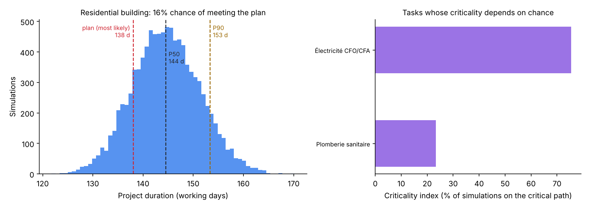

# Construction Project Risk Engine

Quantifies schedule and cost risk on construction projects: three-point estimates per task, Monte Carlo simulation through the critical path, probability of meeting the deadline and budget, and the tasks that drive the delay.

[](https://github.com/alaaeddinethr/Risk-Engine/actions/workflows/ci.yml)


## The problem

A site schedule is usually built by adding up the *most likely* duration of each task along the critical path. That plan is almost never met, for two reasons:

1. Task durations are skewed: a task can finish a little early but very late, so the average is longer than the most likely value.
2. When several paths run in parallel and merge (structure, then MEP trades, then finishes), the project waits for the slowest one. Any of them slipping delays everything ("merge bias").

Large projects routinely overrun: Flyvbjerg (2014) reports that nine out of ten megaprojects exceed their budget. This engine puts a number on that risk before work starts.

## Results

Three sample projects (18 to 28 tasks), 10,000 simulations each. The contract is set to the deterministic most-likely plan, as a planner without risk analysis would. Reproduce with `python scripts/make_readme_figures.py`.



| Project | Plan | P50 | P90 | P(on time) | P(within budget) |
|---|---|---|---|---|---|
| Residential building, 18 tasks | 138 d | 144 d | 153 d | **16 %** | 12 % |
| Office complex, 28 tasks | 186 d | 197 d | 207 d | **8 %** | 10 % |
| Infrastructure, 22 tasks | 136 d | 146 d | 156 d | **8 %** | 8 % |

**What this tells a project manager:** the most-likely plan has less than a one-in-five chance of being met. To commit to a date with 90 % confidence on the residential building, 15 working days of schedule contingency are needed. Electrical works sit on the critical path in 75 % of scenarios and plumbing in 23 %: those two trades are where to secure crews and supplies first. The more tasks run in parallel (the office complex), the lower the chance of meeting the plan.

## Method

| Step | What it does |
|---|---|
| **Beta-PERT** | Each task gets optimistic, most likely and pessimistic durations and costs. Mean = (O + 4M + P) / 6. Sampling uses the Beta-PERT distribution. |
| **Critical path (CPM)** | Forward and backward pass on the dependency graph, total float per task. The baseline is the critical-path length with PERT means. |
| **Monte Carlo** | 10,000 scenarios: sample every task, recompute the critical path, record project duration, cost and which tasks were critical. |
| **Risk indicators** | P50/P80/P90 dates, probability of meeting deadline and budget, cost-overrun VaR (P95 cost − baseline), criticality index per task. |
| **Sensitivity** | Spearman correlation between each task's duration and the project duration (tornado chart in the dashboard). |

## Project structure

```
src/
├── data/project_generator.py   # residential, commercial and infrastructure sample projects
├── schedule/
│   ├── pert.py                 # Beta-PERT estimates and sampling
│   └── cpm.py                  # critical path method, floats
├── risk/
│   ├── monte_carlo.py          # schedule and cost simulation
│   └── sensitivity.py          # Spearman sensitivity, tornado data
└── dashboard/app.py            # Streamlit dashboard
scripts/make_readme_figures.py
tests/test_all.py               # 47 unit tests
```

## Run it

```bash
pip install -r requirements.txt
python src/data/project_generator.py --type residential --output data/project.json
python src/risk/monte_carlo.py --project data/project.json --simulations 10000
streamlit run src/dashboard/app.py
pytest tests
```

## Limitations

- Task durations are sampled independently. In reality bad weather or a late supplier hits several tasks at once; correlated sampling would widen the distribution further, so these probabilities are optimistic.
- Costs are not yet linked to duration (a late task also costs more in labour and equipment).

## References

- Flyvbjerg, B. (2014). What you should know about megaprojects and why. *Project Management Journal*, 45(2).
- Vose, D. (2008). *Risk Analysis: A Quantitative Guide*. Wiley.
- Malcolm, D. G. et al. (1959). Application of a technique for research and development program evaluation. *Operations Research*, 7(5).

---

Alaa Eddine Tahir, engineering student at Arts et Métiers. Built after a site engineering internship at KA2C Construction, Casablanca (2025). [LinkedIn](https://linkedin.com/in/alaaeddine-tahir)
